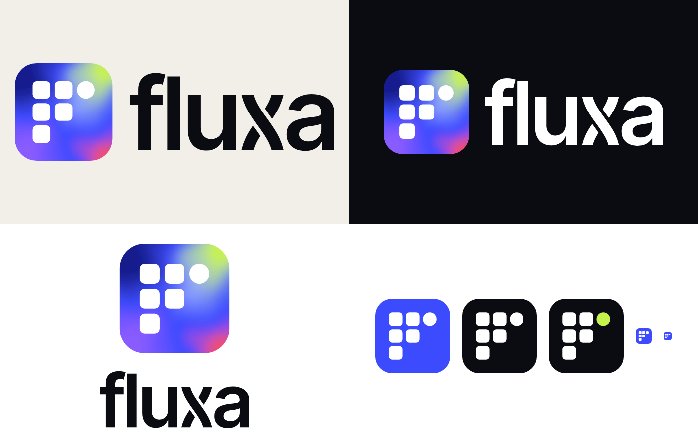

# Fluxa · Logos

Logo oficial da **Fluxa** (fluxawork.com.br): o **F de módulos** dentro do quadro de fluido, com o nome em Inter Tight e o x trançado.

- `svg/` para site e design (escala sem perder qualidade).
- `png/` com fundo transparente, para redes, documentos e apresentações.

## Qual arquivo usar

| Situação | Arquivo |
|---|---|
| Site, apresentações, documentos (fundo claro) | `horizontal/fluxa-horizontal-principal` |
| Fundo escuro | `horizontal/fluxa-horizontal-negativa` |
| Fundo azul, colorido ou foto | `horizontal/fluxa-horizontal-branca` |
| Impressão em 1 cor | `horizontal/fluxa-horizontal-preta` ou `-azul-solido` |
| Espaço quadrado ou alto (capa, cartaz, crachá) | `vertical/fluxa-vertical-principal` |
| Avatar de redes, favicon, app | `icone/fluxa-icone-fluido` |
| Ícone em fundo escuro, com o nó de IA em lima | `icone/fluxa-icone-destaque-ia` |
| Só o símbolo, sem o quadro | `simbolo/fluxa-simbolo-solto-*` |
| Só o nome | `nome/fluxa-nome-preto` ou `-branco` |

## Regras rápidas
- **Cores:** Azul Fluxa `#3D4BFF` · Tinta `#0B0B12` · Lima IA `#C6F24E` (só no nó de IA) · Creme `#F2EFE9`.
- **Respiro:** deixe livre em volta da logo pelo menos 1 módulo (a altura de um quadradinho do símbolo).
- **Tamanho mínimo:** horizontal 96 px / 22 mm · vertical 48 px / 12 mm · ícone 16 px / 5 mm.
- **Não:** esticar, girar, trocar cores, pôr sombra ou efeito, usar só o contorno, colocar sobre fundo poluído, redigitar o nome em outra fonte.

O manual completo da marca (PDF) fica com a equipe da Fluxa.
